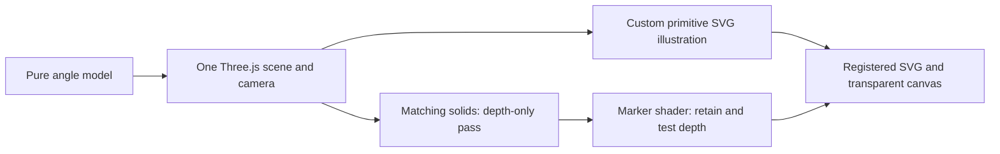

# Three.js prototype decision

Historical M2 evidence. The subsequent packaged migration is documented in [the M3 report](history/three-migration-report.md); revision-2 production parity is tracked separately.

**Recommendation: proceed with a separately scoped migration for the supported primitive/camera contract.** One Three.js hierarchy and camera drive both render paths, and matching solid geometry correctly occludes the marker in the tested poses. Three.js supplies transforms, projection, mesh raycasting and WebGL management; the SVG adapter retains illustration styling and checked ordering. The user has explicitly deferred the 33 ms diagnostic budget, so local timing does not block this recommendation. The production baseline remains intact under the PRD's phase boundary while that migration is scoped; this experiment is not advertised as a second production engine.

The runnable light (local evidence: `out/three-hybrid/light.html`) and dark (local evidence: `out/three-hybrid/dark.html`) pages are standalone. Source is [experiments/three-hybrid](../experiments/three-hybrid/README.md). The machine report (local evidence: `out/three-hybrid/evidence/report.json`) records input artifact hashes and the current validation policy. The last budget-enforced run (local evidence: `out/three-hybrid/evidence/budget-enforced-report.json`), initial completed run (local evidence: `out/three-hybrid/evidence/initial-complete-report.json`), and performance investigation (local evidence: `out/three-hybrid/evidence/performance-investigation.json`) are preserved unchanged. P07 is now reported as a measurement with its budget deferred, never relabeled as meeting 33 ms.

The post-deferral build and complete prototype test ran successfully (exit 0), including the Node 22 completion run (local evidence: `out/reports/prd-completion.json`), with no unexpected browser errors. Additional checks exercised the actual controls at both widths and WebGL context loss. The generated HTML is byte-identical to the previous tested prototype; the policy change does not imply a rendering or performance optimization.

## What Three.js owns

One `THREE.Scene`, one Z-up `THREE.OrthographicCamera`, all primitive meshes, and one rotating group are authoritative. Camera azimuth is 45°, elevation 30°; resize changes only the orthographic extent. Pure model input is 0–360 degrees. Named poses are hidden/rest 243°, crossing 234°, and foreground 27°. The moving marker is a camera-facing disc attached to that group.

The overlay clears color/depth once, renders the same solid meshes with color writes disabled, restores their materials, then renders only the marker with depth testing and no intervening clear. The canvas uses premultiplied alpha and a DPR cap of 1.5. It has no independent camera or scene. No broad blur, support mask, or layer bias hides registration errors. The luminous surface has a bounded radial halo; it is not volumetric light or smoke.

The custom renderer implements `domElement`, `setSize`, `render`, and `dispose`. Box/cylinder/disc helpers generate both mesh geometry and namespaced illustration metadata from the same parameters. Four side tones, cap faces, merged cylinder side bands, silhouettes and scale marks come from primitive knowledge. Cylinders use 128 matching segments; tessellation edges are not stroked. Painter ordering uses projected overlaps and depth-ray constraints followed by a deterministic topological order. It rejects detected interleaving and cycles rather than inventing an order bias.

This is a supported-scene contract, not universal occlusion correctness. Finite overlap probes can miss an untested construction. Unsupported/unannotated geometry fails explicitly. General intersecting meshes, arbitrary assets, transparency sorting, unrestricted orbit, revolved-profile tools and shader conversion to SVG are outside scope. No revolved profile was needed.

## Evidence and inspection

| ID | Executed evidence | Result |
| --- | --- | --- |
| P01 | Five actual GPU-rendered color fiducials, pixel-centroid readback versus SVG projection; 390/960 CSS px at DPR 1/2 | Maximum error 0.150 CSS px, below 0.5. Screenshot registration inspected. Device DPR 2 uses overlay DPR 1.5. |
| P02 | Both themes at 243°, 234°, 27°; masked and unmasked alpha readback | Hidden 0 visible pixels; crossing 686/1361 (50.4%); foreground 1363/1363. Zero opaque-interior leaks. |
| P03 | Each theme: 24 uniform samples every 15°, plus ten crossing samples 225–255° | 68 observations including repeated boundary samples. No observed ordering inversion/pop in either inspected contact sheet; zero detected interior leaks. |
| P04 | Full named views and 4× occlusion/silhouette crops in both themes | Inspected by implementing agent. No triangle grid, obvious normal-size faceting or visible registration seam in these views. Four-tone bands are intentional. |
| P05 | WebGL disabled, actual context loss, and reduced-motion emulation tested separately; pointer/keyboard/named controls at both widths | Vector marker fallback and controls work after context loss; Home/End/arrows, drag and pose buttons agree with model/readout. Reduced motion updates immediately without a pending frame. Actual GPU rendering was required for P01–P03. |
| P06 | 20 resizes; five mount/dispose cycles; hidden/offscreen scheduler checks | Alignment retained; canvases, scene children, GPU geometry/textures and pending frames cleared. After disposal, synthetic input/click/resize/visibility events produced no renders or scheduled frames; AbortController/disconnect remove listeners/observers. |
| P07 | 1 s warmup followed by 10 s moving scene | **Budget deferred by user; measurements retained.** Current median 66.6 ms, p95 66.7 ms; 163 samples; 104 SVG descendants; HTML 577,544 bytes. Last budget-enforced run: 66.7 / 116.7 ms, 130 samples. Initial run: 66.6 / 66.7 ms, 168 samples, 576,606 bytes. |
| P08 | Stock addon and custom SVG render the same solid scene, plus unsupported-sphere probe | Custom shading, outlines and scale marks preserve the intended visual language. Stock remains a useful comparison; detailed costs below. |

The light contact sheet (local evidence: `out/three-hybrid/evidence/light-contact-sheet.png`), dark contact sheet (local evidence: `out/three-hybrid/evidence/dark-contact-sheet.png`), light crossing crop (local evidence: `out/three-hybrid/evidence/light-partial-occlusion-4x.png`), and dark crossing crop (local evidence: `out/three-hybrid/evidence/dark-partial-occlusion-4x.png`) show the tested range and support boundary. All six named full views, the named-pose crops, both stock/custom views, the mobile fallback and GPU fiducial views were inspected. Screenshots are evidence, not automatically accepted regression baselines.

The context-loss fallback (local evidence: `out/three-hybrid/evidence/context-loss-fallback.png`) and refreshed crossing crops were inspected after the deferred-budget run. A locator screenshot stability wait timed out during an earlier attempt; fixed-rectangle captures now use the explicitly settled stage bounds without adding actionability waits. Visibility assertions and pixel readback are unchanged.

The pixel leak test excludes the one-device-pixel antialias boundary when asserting opaque interiors. Edge quality is separately inspected at 4×. GPU and SVG antialiasing are different rasterizers, so these measurements are not a guarantee of identical edge coverage on every device. Sampling every 15° plus crossing poses is not proof for every continuous pose or future scene.

An initial needle intersected its hub and triggered the renderer's interleaving diagnostic. The failure (local evidence: `out/three-hybrid/initial-intersection-failure.json`) is preserved. Moving the needle's inner endpoint to the hub boundary made the geometry orderable; no sorting bias was introduced. Visual comparison also caught the stock addon's default white background in dark mode. The final comparison explicitly sets the same theme background and 0.001-pixel serialization precision and excludes the WebGL marker from both SVG-only views.

## Performance investigation

Measured environment: Darwin 24.6.0 x64, Intel Core i5-8257U at 1.40 GHz, eight logical cores, Node 22.12.0 for the current full run (24.22.0 for the earlier runs and separate profile), Playwright 1.64.1, Chromium 156.0.8078.4. Viewport 960×1000 CSS px; drawing rectangle 842×561.328 CSS px; device/overlay DPR 1. GPU renderer was ANGLE Vulkan SwiftShader (Subzero), a software renderer. Launch flags are retained in the machine report. No hardware-accelerated browser result is claimed.

A separate diagnostic executes 80 callbacks per mode, discards the first eleven, and records 69 intervals. It does not replace the required ten-second measurement:

| Mode | Median / p95 callback interval | Median / p95 JS submission cost |
| --- | --- | --- |
| Empty clock | 16.7 / 16.7 ms | 0 / 0 ms |
| SVG only | 50 / 100 ms | 52.5 / 96.2 ms |
| WebGL only | 33.3 / 50 ms | 0.3 / 0.6 ms |
| Hybrid | 83.3 / 133.3 ms | 53.1 / 74.7 ms |

The SVG path includes primitive projection, overlap/ray ordering, serialization and DOM replacement; these were not individually profiled. The measurements show substantial SVG work on this CPU and software-WebGL cost in this browser. They do not isolate implementation efficiency from hardware capability, establish performance on a hardware GPU, or compare against an equivalent M1 scene. The diagnostic uses a different angle trajectory and is not directly comparable to the required tour's percentiles. The user requested "skip the diagnostic budget for now and continue": the measurement window remains unchanged and the 33 ms comparison is no longer a pass/fail gate. The earlier architecture recommendation gave this local diagnostic excessive weight; these timings do not establish that Three.js is unsuitable.

## Stock comparison and maintenance cost

The pinned Three.js 0.186.1 addon source was inspected without modification. The comparison uses identical meshes, transforms, camera, per-object MeshBasicMaterial colors, drawing dimensions, background and coordinate precision. It does not assert that stock SVGRenderer cannot be styled or lit differently. Its default triangle expansion can leave subtle radial/facet traces, it does not infer our four-tone sides or semantic outlines from primitive metadata, and it does not generate the dial's marks. The custom output restores these features seen in the M1 baseline (local evidence: `out/dial/figure.svg`), without reproducing all M1 detail.

At 90°, the custom SVG is 37,384 bytes versus 50,012 light / 49,507 dark bytes for stock at equal numeric precision. Stock emits 238 nodes covering 786 triangles; the custom scene has 104 descendants during the moving-scene measurement. These are scene-specific observations, not general compression guarantees.

Three.js removes our need to maintain a transform hierarchy, camera matrix implementation, mesh raycasting and raw WebGL setup. It does **not** remove our primitive metadata, silhouette construction, SVG painter ordering, semantic shading, edge treatment, DOM update strategy, GPU/SVG compositing or visual audits. The custom renderer is about 8 KB of source, with a separate depth overlay of about 2.4 KB; client source includes substantial evidence-only diagnostics. Even this small scene has a meaningful maintenance burden.

The static light (local evidence: `out/three-hybrid/fallback-light.svg`) and dark (local evidence: `out/three-hybrid/fallback-dark.svg`) SVG exports use a solid vector marker. They do not embed a rasterized shader or promise realistic shader output in SVG. Runtime WebGL initialization/context loss switches to the same vector representation. Shader compilation failures remain errors, not successful evidence.

## Concrete next work

1. Carry the supported boxes/cylinders/discs and fixed camera into a separately scoped Three.js migration. Preserve the current model/config/export contracts and required standalone vector output.
2. Separate reusable runtime code from evidence-only diagnostics, and retain primitive metadata, explicit unsupported-geometry errors and the existing visual/occlusion fixtures.
3. Add adversarial crossing fixtures and finer boundary sampling before extending the supported primitive arrangements. Treat every new camera range as new visibility work.
4. Revisit performance later: profile SVG work by stage and repeat on hardware-accelerated browsers before choosing optimizations or a device-specific budget. This is deferred work, not a prerequisite to continued implementation.
5. Preserve M1 until migration parity is demonstrated. A general mesh engine remains outside scope.

Reproduce after the [repository setup](../README.md): `npm run prototype:build` and `npm run test:prototype`. The optional `node tests/prototype-profile.mjs` performs additional timing investigation. The prototype test fails for correctness errors or missing measurements; exceeding 33 ms no longer changes its exit code. Chromium installation and permission to launch it are prerequisites. No external service, publishing, or account is involved.

Design references consulted: [OrthographicCamera](https://threejs.org/docs/pages/OrthographicCamera.html), [SVGRenderer](https://threejs.org/docs/pages/SVGRenderer.html), [ShaderMaterial](https://threejs.org/docs/pages/ShaderMaterial.html), and [DepthTexture](https://threejs.org/docs/pages/DepthTexture.html). These explain the relevant capabilities; the pinned installed source and this experiment's measurements determine the implementation, not an assumption that SVG and WebGL share depth.
